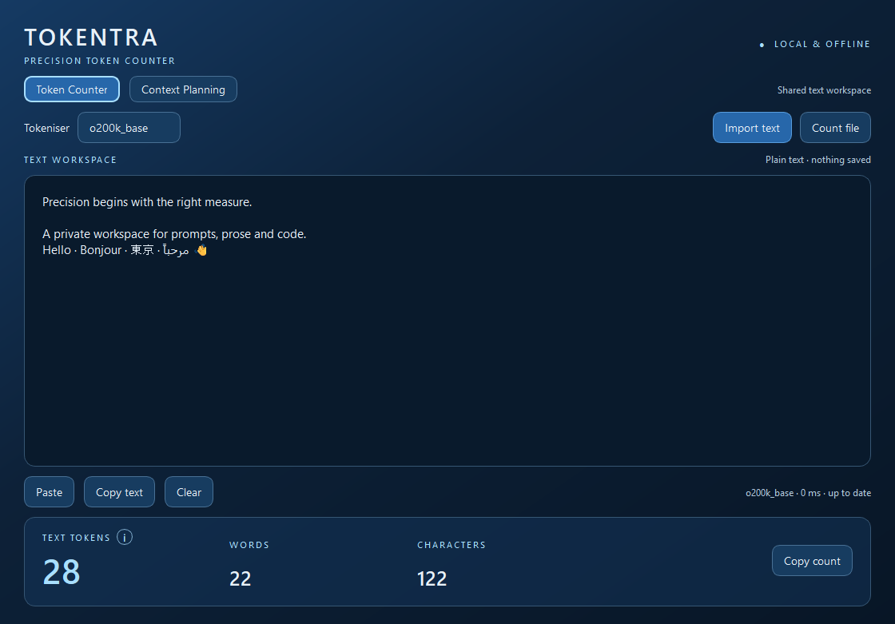
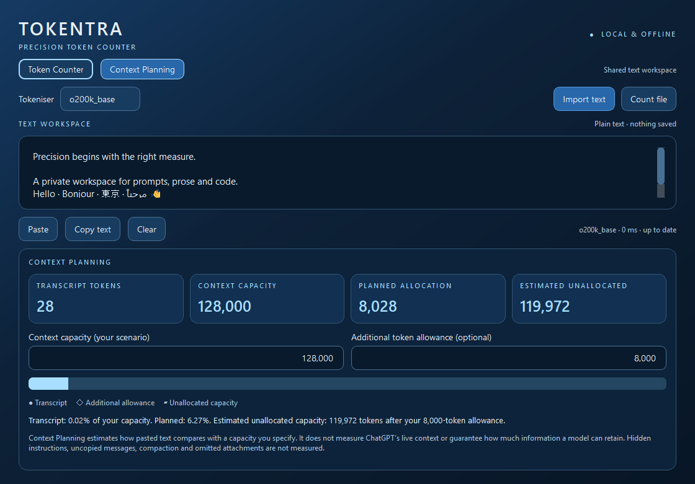

# Tokentra | Precision Token Counter

A dedicated offline desktop workspace for accurate OpenAI text token counting and interactive context planning.

Tokentra uses tiktoken locally, with a focused native interface for substantial text inputs. It needs no browser, API key or internet connection and does not transmit or automatically save your text.
The approved reference is [Tokentra_Product_Specification.md](Tokentra_Product_Specification.md).



## Status and platform support

**Tokentra 1.0.0 for Windows 11 x64** is the first Windows release. macOS and Linux share the
source and native packaging configuration, but packages for those platforms have not been released or validated.
See the [release evidence](docs/RELEASE_READINESS.md) and [redistribution assessment](docs/COMPLIANCE.md).

## Windows installation and uninstallation

Download [Tokentra-1.0.0-windows-x64-setup.exe](https://github.com/ezequiel-gb/Tokentra/releases/download/v1.0.0/Tokentra-1.0.0-windows-x64-setup.exe)
from the [v1.0.0 release](https://github.com/ezequiel-gb/Tokentra/releases/tag/v1.0.0).
Compare its SHA-256 with `SHA256SUMS.txt` from that release before running it.
Close Tokentra, open the installer in File Explorer and follow the wizard. Setup presents
Microsoft runtime terms applying only to Microsoft components; Tokentra remains MIT licensed.
No Python installation, API key or account is required. The per-user installer normally
requires no administrator rights and uses `%LOCALAPPDATA%\Programs\Tokentra`.
Launch **Tokentra** from the Start menu or optional desktop shortcut.

To uninstall, close Tokentra and choose **Settings → Apps → Installed apps → Tokentra → Uninstall**.
The uninstaller removes installer-created files and shortcuts, retaining preferences and unrelated files.
Upgrading from RC3 uses the same application identity and retains valid preferences.
Text is never automatically saved. A conventional installer is the only binary distribution;
no portable ZIP is offered.

The installer is **unsigned**. Windows may display publisher or reputation warnings.
Verify the download source and checksum; do not disable security protections.
Application operation and tokeniser initialisation are entirely local after installation.

## Features

- Spacious text workspace with the Refined Blue Glass palette and native window controls.
- Automatic background counting, 220 ms typing debounce, latest-request coalescing and stale-result rejection.
- `o200k_base` (default), `cl100k_base` and `p50k_base`, all bundled locally with SHA-256 verification.
- Token, whitespace-delimited word and Unicode code-point character counts.
- Paste, copy complete text, clear, copy numerical token count and strict plain-text import.
- Separate **Count file** action for counting without inserting the document into the editor.
- Context Planning: shared editor, editable capacity/reserve, exact totals, utilisation and excess visualisation.
- Persistent window geometry, selected encoding, mode and numerical planning preferences only. Document text is never automatically saved or logged.
- Native minimise, maximise, restore and resize; F11 full-screen and Escape to leave full-screen.
- Startup and restore geometry constrained to Qt's available work area, including the native title bar and frame.

## Counting and text policy

The outlined **i** beside **Text Tokens** provides the counting explanation on hover, keyboard focus or activation.
Tab reaches it; Escape dismisses its tooltip. The former permanent technical footer has been removed.


Counts are exact for the complete source string under the selected encoding using official `tiktoken.Encoding.encode_ordinary`.
Special-token-looking strings, including `<|endoftext|>`, are always ordinary text.
These are raw-text counts, not ChatGPT conversation usage or complete API billing predictions.
Encoding names are shown directly; no model compatibility claims are inferred.

Words are runs of non-whitespace characters, equivalent to `len(text.split())` with Python's Unicode whitespace rules.
Characters are Unicode code points, equivalent to `len(text)`, not grapheme clusters or UTF-16 units.
A CRLF pair therefore counts as two characters. A multi-code-point emoji can count as several characters.

Imports decode UTF-8, UTF-8 with BOM, or BOM-marked UTF-16/32, strictly. Other encodings must be converted externally.
NUL-containing files are rejected as likely binary. Filename extensions do not determine decoding.
Failed reads and decoding leave existing editor content intact and invalidate the previous result.
Original imported and pasted CRLF/CR endings are preserved in the source used for counting and copying.
Qt displays these as line breaks. New keyboard line breaks use LF; undo restores Qt's textual representation
of removed content, so restored line breaks may use LF. Counts always follow the current in-memory source.

**Count file** leaves the editor intact and clearly marks the metrics as a file result. Changing encoding in this
mode rereads that file; editing or clearing returns to editor counting. Files must still fit in memory.
Counting is performed on the complete string, never as independently tokenised chunks.

## Context Planning

Switch between **Token Counter** and **Context Planning** using the mode buttons. The editor and encoding are
shared; mode and scenario changes reuse the current count. Capacity defaults to 128,000 and additional allowance
to 8,000 tokens. Both are your own editable scenario, not model capacity claims or measured ChatGPT overhead.
Whole numbers accept optional comma thousands separators. Capacity must be positive; allowance may be zero.

For capacity C, transcript T and allowance R, planned allocation is T+R and estimated unallocated capacity is
C-T-R. Negative values remain visible and an explicit excess is reported. Percentages compare T and T+R with C.
The allocation bar clips to capacity on overflow; it never invents remaining space. Planning gives more height to the dashboard while Token Counter prioritises editing. Cards use font-aware
widths and equal columns, keeping complete numerical values visible. The dashboard rearranges and scrolls
independently in small windows. Very short windows use tighter spacing and hide only the secondary branding
caption so the editor retains readable text lines and the dashboard stays inside the window. Tab navigates scenario inputs and selectable numerical cards.

This estimates pasted text; it cannot inspect live ChatGPT context, hidden instructions, compaction, uncopied
messages or attachments. **Count file** is a separate result and suspends planning until text is imported into
or edited in the shared workspace. No transcript history is stored.



## Keyboard shortcuts

| Action | Windows / Linux | macOS |
|---|---|---|
| Import | Ctrl+O | Cmd+O |
| Copy count | Ctrl+Shift+C | Cmd+Shift+C |
| Clear | Ctrl+L | Cmd+L |
| Full-screen | F11 | F11 |
| Leave full-screen | Escape | Escape |
| Quit | Standard platform quit shortcut | Cmd+Q |

Standard editor copy, paste, cut, select-all, undo and redo use Qt's platform shortcuts.

## Develop

Python 3.11+ is required; this build was tested with Python 3.12.14 on Windows 11 x64.

```powershell
python -m venv .venv
.venv\Scripts\python -m pip install -r requirements-dev.txt
.venv\Scripts\python -m app.main
.venv\Scripts\python -m pytest -q --basetemp .test-tmp
```

On macOS/Linux, activate `.venv/bin/activate` and use `python` for the same module commands.
`requirements-lock.txt` records the tested Windows dependency set, including transitive dependencies.
The application needs only PySide6 Essentials and tiktoken; it does not use Qt WebEngine, inference libraries or an API SDK.

All three encoding assets and their manifest are already included. Normal installation, building and first launch
do not need to fetch tokeniser tables. To regenerate assets when deliberately upgrading tiktoken:

```powershell
python scripts/prepare_assets.py
```

That build-time script requires internet access and verifies the tables against hashes from the pinned official
tiktoken constructors. Review the manifest and rerun reference tests after any upgrade. The application never imports this script.

## Build a standalone package

```powershell
python scripts/collect_licences.py
python -m PyInstaller packaging/tokentra.spec --distpath dist-final --workpath build-final
python scripts/check_packaged.py --dist-dir dist-final --report offline-packaged.json
python scripts/audit_package.py --dist-dir dist-final --report package-audit.json
```

Build the primary Windows installer using Inno Setup 6.7.3:

```powershell
& .tools\InnoSetup6\ISCC.exe packaging\tokentra.iss
```

See [installer maintenance and verification](docs/WINDOWS_INSTALLER.md).
The legacy `scripts/package_release.py` helper creates local evaluation ZIPs; its broad source
collection is not the public-source release path. Prepare the reviewed allowlisted Git tree with
`scripts/prepare_source.py`, then use `git archive` from its exact recorded commit for a public
source archive. The primary distribution is setup, with Microsoft runtime licence acceptance.
A portable binary needs an equivalent recipient-terms arrangement before distribution.
Preserve previous candidates. Complete Qt/PySide source archives must accompany eventual
binary downloads; see [source and replacement guidance](docs/QT_REPLACEMENT.md).

The normal executable has a Windows GUI subsystem, icon and product/version metadata. Runtime packaging omits
the URL-backed tokeniser loader, requests, PDF image loading and the Qt virtual keyboard/QML runtimes, which this app does not use.
Windows system ICU is used rather than a conflicting development-runtime ICU DLL.

Build separately on each target OS. The spec creates a Windows portable folder, macOS `.app` bundle or Linux
portable folder. `.github/workflows/build.yml` prepares native CI jobs; it has not been dispatched in this workspace.
macOS signing/notarisation, Intel validation, DMG creation, Linux AppImage construction and representative X11/Wayland
testing remain release work. PyInstaller does not cross-compile ([official manual](https://www.pyinstaller.org/en/stable/)).

## Architecture and verification

| Component | Responsibility |
|---|---|
| `app/core/tokenizer.py` | Local integrity-checked encoding construction, independent of Qt |
| `app/core/counter.py` | Exact counts and elapsed time |
| `app/core/workers.py` | One active Qt task, one pending latest request, safe shutdown |
| `app/services/files.py` | Strict decoding with preserved line endings |
| `app/services/settings.py` | Non-sensitive Qt settings |
| `app/ui/editor.py` | Text editing and source line-ending preservation |
| `app/ui/main_window.py` | Application orchestration, dashboard and native window adaptation |
| `app/ui/window_geometry.py` | Frame-aware startup/restore bounds and screen-change handling |
| `packaging/` | Native build specification and dependency licence notices |

See the [current release report](docs/RELEASE_READINESS.md), [Windows manual checks](docs/WINDOWS_VALIDATION.md)
and [mixed-text benchmark data](docs/release-audit/benchmark.json).
Run `python scripts/benchmark_representative.py --report benchmark.json` to measure mixed prose, code and Unicode near 100k and 1m tokens.
The separate `python scripts/benchmark.py` script reproduces the original synthetic baseline.
The benchmark and visual scripts use synthetic text and temporary INI settings, not real document content.

Native Windows smoke checks can be repeated with `python -m app.main --window-check --report window-check.json`.
They briefly open and close test windows using temporary settings. For a packaged build, replace the Python module
command with `Tokentra.exe --window-check --report window-check.json`. These diagnostics do not use your saved preferences.

The runtime directly constructs `tiktoken.Encoding` from local tables and the captured official definitions,
following the constructor interface in [OpenAI's tiktoken source](https://github.com/openai/tiktoken/blob/main/tiktoken_ext/openai_public.py).
It never calls the URL-backed tiktoken registry. Missing or damaged assets cause a local error, with no network fallback.

## Known limitations

- Loading very large documents into Qt can pause the interface. Use **Count file** to avoid editor layout overhead.
  Both synthetic and mixed-text million-token benchmarks succeeded, but arbitrary documents and sizes have no guaranteed
  latency or memory ceiling. Editing near the end of a multi-million-character document can also pause the interface.
- Offline diagnostics block Python socket/DNS access; native process/child endpoint sampling also observed no endpoints.
  This is not packet capture or proof against transient activity. A physically disconnected clean-machine check remains unverified.
- Windows 11 uses native DWM rounded outer corners and square maximised corners. Older Windows and Linux use native
  decoration fallbacks; corner shape and blur depend on the window manager. Native Windows programmatic transitions
  passed at Qt scale factors 1, 1.25, 1.5 and 2. Actual OS scaling changes, manual dragging/snapping, multiple monitors,
  external-monitor disconnection and assistive technologies still need physical desktop testing.
- Active tokenisation is allowed to finish on close; the event loop remains running while it finishes. There is no unsafe cancellation.
## Licence and publication

Tokentra is licensed under the [MIT licence](LICENSE), Copyright (c) 2026 Ezequiel Gomez.
Third-party software retains its own terms; the owner selected community LGPLv3 for Qt/PySide6.
The application licence does not discharge those obligations. See [third-party notices](THIRD_PARTY_NOTICES.md)
and the [compliance assessment](docs/COMPLIANCE.md). The Windows installer includes the scoped
Microsoft runtime acceptance page and full retained third-party notices. Matching QtBase and PySide/Shiboken
source archives are companion assets on the same release, with checksums and
[library replacement instructions](docs/QT_REPLACEMENT.md). These dependency terms apply independently of MIT.
Residual provenance and independent-rebuild recommendations are documented without claiming formal legal certification.
